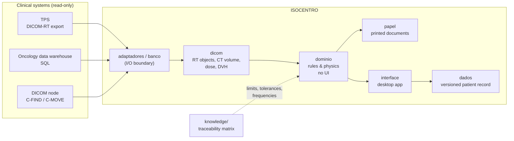

# ISOCENTRO — Radiotherapy Quality Management Platform

**Clinical software for radiotherapy, built and validated by a medical physicist.**
ISOCENTRO is an integrated quality-management system for a radiotherapy department: it reads the
treatment plan straight from DICOM-RT, generates the printed documents that go to the treatment room,
runs an independent dose (MU) verification, scores plan quality, and ties every check back to the
regulation or task-group report that requires it.

It grew out of daily clinical work: every module replaced a manual, error-prone step in a real
radiotherapy department.

> **Anonymized showcase.** Institution names, servers, staff and identifiers have been replaced by
> fictitious equivalents, and no patient data is included. The test suite passes identically before
> and after anonymization. **Not for clinical use** (see [LICENSE](LICENSE)).

---

## At a glance

| | |
|---|---|
| **Platform** | 119 Python modules · ~59k lines · desktop app (PySide6) |
| **Tests** | **2,714 automated tests** (~41k lines) · CI on every push, in normal **and** random order |
| **Knowledge base** | 494 traceable requirements · 226 sources (norms, AAPM TGs/MPPGs, IAEA, ICRU) · 164 curated reference sheets |
| **Varian ESAPI** | 23 C# files · ~16k lines · plan checks and structure automation in Eclipse |
| **Web apps** | 4 tools (Streamlit / Flask) · ~11k lines · incl. LLM document extraction and computer vision |

## What's inside

| Folder | What it is | Stack |
|---|---|---|
| [`platform/`](platform/) | **ISOCENTRO**, the core application: DICOM-RT parsing, treatment-sheet and cover-page PDFs, independent MU check, plan-quality indices, read-only data-warehouse integration, DICOM networking, automation robot | Python, PySide6, pydicom, pynetdicom, NumPy, ReportLab, SQL |
| [`knowledge/`](knowledge/) | **Requirement → reference traceability matrix**: every limit, tolerance and frequency the system enforces points to a document and page | Markdown, CSV, Python generators |
| [`esapi-scripts/`](esapi-scripts/) | **Varian Eclipse scripts**: plan pre-treatment check, quality indices, dose constraints, optimization rings and structures, task-owner automation | C#, Varian ESAPI 15.6 |
| [`apps/srs-plan-quality/`](apps/srs-plan-quality/) | Radiosurgery plan evaluation from DICOM (CI RTOG, Paddick, GI, HI ICRU-83…) with history and PDF report | Streamlit, pydicom, Plotly |
| [`apps/iort-dosimetry/`](apps/iort-dosimetry/) | Intra-operative RT (ZEISS INTRABEAM) database and **computer-vision** classifier that reads the lesion quadrant from the treatment-report diagram | Streamlit, OpenCV |
| [`apps/radiation-protection-plan/`](apps/radiation-protection-plan/) | Radiation-protection plan generator with deadline tracking; **LLM extraction** of structured data from uploaded PDFs | Streamlit, Claude API, ReportLab |
| [`apps/parallel-mu-check/`](apps/parallel-mu-check/) | Earlier web version of the independent MU check, from RT Plan DICOM | Flask, pydicom |

## Architecture



The code is organised by **role in the clinical flow**, not by technology: `banco/` answers "where does
the clinical data come from?", `dominio/` holds the rules and calculations with no UI, `papel/` is
everything that gets printed. See [`platform/README.md`](platform/README.md) for the full map.

## Engineering principles

- **Anchored in references, never invented.** Tolerances come from norms and task groups (AAPM TG-218,
  TG-219, TG-263, TG-275, MPPGs, IAEA, ICRU), recorded in the traceability matrix with document and
  page. A field with no source is left **empty** and flagged; the system never guesses.
- **Validated against analytic ground truth.** Geometry is tested with synthetic phantoms that have a
  closed-form answer (a cylinder of radius *R* has SSD = SAD − *R*), not against the TPS printout, which
  was found to be wrong in at least one archived case.
- **Read-only towards clinical systems.** The data warehouse and DICOM nodes are only read; writes to the
  TPS go exclusively through validated ESAPI scripts in a non-clinical environment.
- **Degrade loudly.** Data comes from a three-step chain (database → per-patient mirror → exported
  reports), and the screen always says which step answered and how old it is. A silent fallback becomes
  the norm in two weeks.
- **One machine, one beam table.** The independent MU check refuses to borrow commissioning data from a
  similarly named machine; without the exact table it runs as demonstration only, with no verdict.
- **Privacy by construction.** Pseudonymized identifiers in all fixtures, and a pre-commit scanner
  ([`varrer_identidade.py`](platform/tools/varrer_identidade.py)) that blocks real patient identifiers.
- **AI-assisted, human-owned.** Developed with Claude Code under versioned hooks, commands and project
  rules ([`platform/.claude/`](platform/.claude/), [`platform/CLAUDE.md`](platform/CLAUDE.md)). Quality
  documents (scope, IEC 62304 classification, risk analysis in [`platform/docs/qms/`](platform/docs/qms/))
  are written by the physicist, never by the AI.

## Running

```bash
cd platform
python -m venv .venv && source .venv/bin/activate      # Windows: .venv\Scripts\activate
pip install -r requirements.txt -c constraints.txt
python run_gui.py                                       # desktop app
QT_QPA_PLATFORM=offscreen python -m unittest discover -s tests
```

The suite targets **Windows**, the platform of the clinical workstations (several tests check Windows
path rules), which is why CI runs it on `windows-latest`. Each app in `apps/` has its own README.

## Language

Code, comments and UI are in **Brazilian Portuguese**, the language of the users. Comments explain
*why* a choice was made, and usually what broke when it was done differently.

## Author

**Geovani Pires Pena** · Medical physicist (radiotherapy), ABFM-certified · clinical software & AI
validation · [GitHub](https://github.com/geovanipena)

---

<details>
<summary><b>Resumo em português</b></summary>

ISOCENTRO é um sistema integrado de gestão da qualidade em radioterapia: lê o plano direto do DICOM-RT,
gera a ficha técnica e a capa que vão para a sala de tratamento, faz a verificação independente de UM,
calcula índices de qualidade do plano e liga cada verificação à norma ou ao task group que a exige.
Este repositório é uma vitrine anonimizada: nomes de instituição, servidores, equipe e identificadores
foram trocados por equivalentes fictícios, e não há dado de paciente. Não é para uso clínico.

</details>
