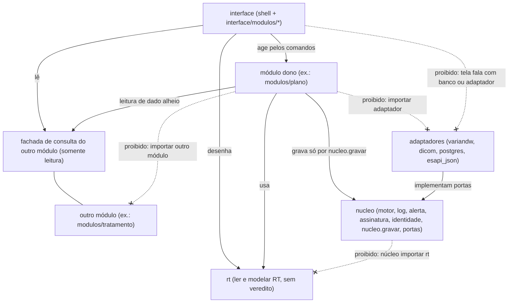
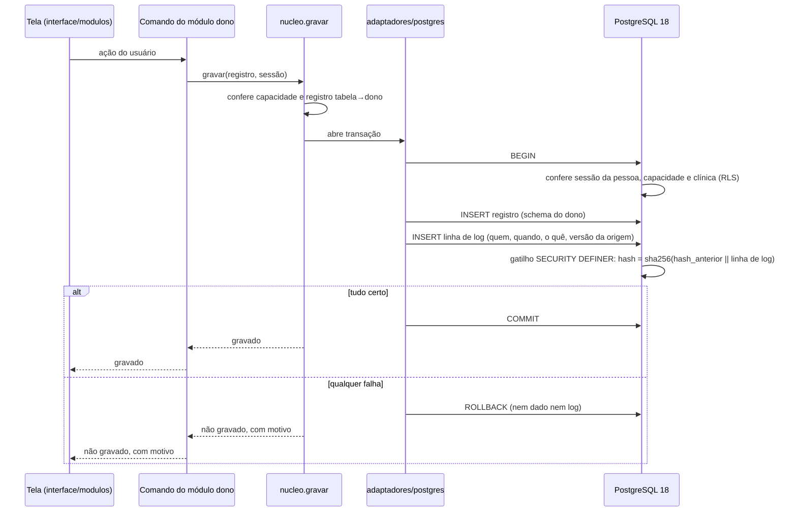
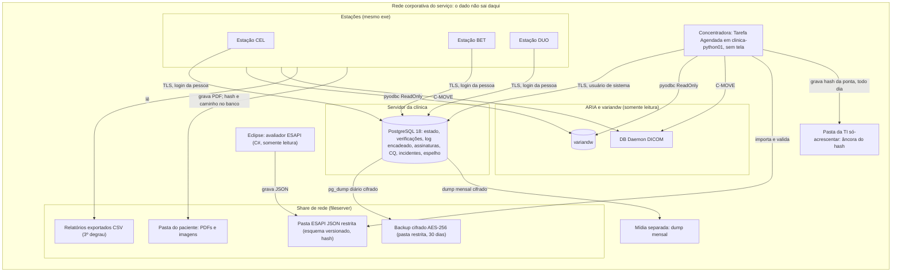

# Espinha de arquitetura — ISOCENTRO

## Paradigma

**Monólito modular** com **portas e adaptadores**. Um só executável e um só código; dentro dele:

| Camada | Pacote-alvo | O que é |
| --- | --- | --- |
| Núcleo | `isocentro/nucleo/` | sem conhecimento de radioterapia: motor de verificação, catálogo, execução, log encadeado, alerta, assinatura, identidade, entidades de referência, exportador, portas |
| Radioterapia comum | `isocentro/rt/` | lê e modela objetos de RT (RT Plan, RT Dose, RT Struct, série de TC), geometria, cortes, DVH; sem veredito, sem estado, sem I/O (AD-38) |
| Módulos verticais | `isocentro/modulos/<modulo>/` | `plano`, `tratamento`, `qualidade`, `seguranca`, `documentacao`, `software`, `indicadores`, `conhecimento`, `radioteraficha`; cada um é um conjunto de verificações sobre o núcleo, com seus dados, sua fachada de consulta e seu `MANIFESTO` (AD-40) |
| Adaptadores | `isocentro/adaptadores/` | `variandw`, `dicom`, `postgres`, `esapi_json`; implementam as portas do núcleo |
| Interface | `isocentro/interface/` (shell) e `isocentro/interface/modulos/<modulo>/` | Qt na borda (PyQt5 hoje, PySide6 como alvo, AD-36); telas de módulo |

Direção de dependência (é regra, imposta pelo AD-22):



O Radioteraficha atual migra para `modulos/radioteraficha` aos poucos. Rejeitados: camadas horizontais e plug-ins em tempo de execução.

## Invariantes e regras

### AD-1 — Monólito modular com núcleo sem RT

- **Binds:** all
- **Prevents:** regra de radioterapia espalhada no núcleo; módulo implantado como processo ou plug-in separado.
- **Rule:** o núcleo não conhece radioterapia; cada módulo do MVP é um conjunto de verificações sobre o núcleo; tudo roda no mesmo executável, sem carregamento de plug-in em tempo de execução.

### AD-2 — Direção de dependência

- **Binds:** all
- **Prevents:** núcleo ou módulo acoplado a Qt; módulos acoplados entre si; módulo gravando por fora do núcleo; tela acoplada ao banco.
- **Rule:** `interface → modulos → nucleo ← adaptadores`, e `modulos → rt`, `interface → rt` (AD-38). O núcleo não importa Qt, `interface`, `modulos`, `rt` nem adaptador concreto. `rt` não importa nada do pacote além de si mesmo. Adaptador não importa `rt`: devolve o dado cru (ex.: `pydicom.Dataset`) e quem chama o entrega ao `rt`. `isocentro/composicao.py` importa só `modulos/*` e núcleo; `interface/composicao.py` importa telas (AD-40). Módulo não importa Qt (PyQt5 ou PySide6), adaptador nem outro módulo (exceto a fachada de consulta dele, AD-3). Tela não importa adaptador nem banco.

### AD-3 — Dono único do dado e comunicação entre módulos

- **Binds:** modulos/*, nucleo
- **Prevents:** dois donos de uma entidade; ação de um módulo executada fora do log.
- **Rule:** (1) cada dado tem um só dono (módulo ou núcleo), e só ele grava em suas tabelas, sempre por `nucleo.gravar` (AD-27); (2) leitura de dado de outro módulo só pela fachada pública de consulta dele (ex.: `modulos/tratamento/consulta.py`, somente leitura); (3) reação a algo de outro módulo só pelo motor do núcleo (gatilho `evento`/`estado`/`prazo`/`calendario` → verificação → alerta → log); (4) é proibido gravar em dado alheio ou chamar outro módulo para executar ação.

### AD-4 — Gravação e log na mesma transação, log único

- **Binds:** FR-3, FR-8, nucleo, adaptadores/postgres
- **Prevents:** dado gravado sem linha de log, ou log sem o dado; correntes paralelas por módulo.
- **Rule:** existe uma só tabela de log, do núcleo; nenhum módulo cria log ou histórico próprio. Toda gravação de dado grava, na mesma transação do banco, a linha de log (quem, quando, o quê, versão do dado de origem). Tudo ou nada. A linha de log guarda referência ao registro, nunca texto livre (AD-33).

### AD-5 — Nada se apaga nem se edita

- **Binds:** all (inclusive o atual `correcoes.py`)
- **Prevents:** perda de histórico; correção que sobrescreve o original; cada módulo marcando "substituído" de um jeito.
- **Rule:** correção = novo registro que aponta o anterior; o registro vigente é calculado (é o que nenhum outro substitui), sem UPDATE para marcar. Sem UPDATE de conteúdo nem DELETE em dado registrado. Exceção única e declarada: o espelho do `variandw` é cache (AD-17), fora desta regra.

### AD-6 — Corrente de hash global no banco e papéis de banco

- **Binds:** FR-3, adaptadores/postgres, migracoes
- **Prevents:** corrente quebrada por duas estações gravando ao mesmo tempo; corrente invisível ao gatilho por causa do RLS; app capaz de reescrever o log.
- **Rule:** uma só corrente, global para as três clínicas. O hash é calculado por gatilho do PostgreSQL `SECURITY DEFINER`, `sha256(hash_anterior || linha de log)`, com ordem serializada pelo banco. Papéis de banco: `isocentro_app` e `isocentro_concentradora` só INSERT/SELECT no log (UPDATE/DELETE negados); `isocentro_dono` só para DDL e migração.

### AD-7 — Dado do paciente não sai da rede do serviço [ADOPTED]

- **Binds:** NFR-2, all
- **Prevents:** recusar o banco central por uma regra "não sai da máquina" que o código já não cumpre; dado indo a serviço de terceiros.
- **Rule:** dado de paciente ou de funcionário não sai da rede do serviço (nem para log, repositório, terceiros ou IA). Banco central e share na rede corporativa são permitidos; passar dado entre CEL, BET e DUO não é sair da rede.

### AD-8 — Unidades CEL, BET e DUO [ADOPTED]

- **Binds:** NFR-6, AD-12, todo dado com clínica
- **Prevents:** códigos de unidade divergentes entre módulos e tabelas.
- **Rule:** as unidades do sistema são `CEL`, `BET` e `DUO`. O código migra `ANA` → `DUO` (mesma unidade, nome canônico DUO). SAT é outra clínica, fora do MVP.

### AD-9 — Topologia e destino do que se grava

- **Binds:** all, operação
- **Prevents:** gravação concorrente em JSON no share; serviço ou API próprios entre estação e banco; estado dividido entre arquivo e banco.
- **Rule:** o app desktop de cada estação fala direto com o banco central no servidor da clínica, `clinica-python01` (mesma máquina da concentradora). Todo estado (usuários, sessões, equipe, checklist, `registro_json`, `cadastro_sus`, correções, configuração) migra para o PostgreSQL; PDFs e imagens ficam na pasta do paciente, com hash e caminho registrados no banco. A **concentradora** (`run_varredura.py`, sem tela) é Tarefa Agendada em `clinica-python01` [ADOPTED] e executa gatilhos de tempo e prazo com o app fechado (AD-28).

### AD-10 — Banco central PostgreSQL 18

- **Binds:** NFR-10, adaptadores/postgres
- **Prevents:** SQLite com vários hosts gravando por SMB; libpq ausente na estação.
- **Rule:** banco central = PostgreSQL linha 18.x no servidor da clínica, driver `psycopg[binary]` 3.3. SQLite só para `banco_local` (cache de leitura do `variandw`, nunca destino de gravação) e testes de unidade. PostgreSQL e psycopg entram no inventário SOUP.

### AD-11 — Capacidade conferida no núcleo e no banco

- **Binds:** FR-7, FR-8, nucleo, interface
- **Prevents:** permissão decidida por esconder aba; cada módulo inventando sua checagem de perfil; capacidade conferida só no cliente.
- **Rule:** perfil → lista de capacidades (ex.: `assinar_aprovacao_fisica`, `assinar_duplo_check`, `cadastrar_verificacao`, `registrar_cq`, `registrar_incidente`, `admin`) numa tabela única do núcleo. O núcleo e o banco (pela sessão do AD-25) conferem a capacidade no ato; a tela esconder é só conforto.

### AD-12 — Visibilidade por clínica com RLS pela sessão

- **Binds:** NFR-6, todas as tabelas
- **Prevents:** consulta que esquece o filtro de clínica; `NULL` ou "TODAS" como clínica; concentradora passando por cima do RLS.
- **Rule:** toda tabela é **de clínica** (coluna `clinica` obrigatória com `CEL`/`BET`/`DUO` e política RLS) ou **global** (sem coluna de clínica e sem RLS). O RLS usa as clínicas da sessão devolvida pelo banco no login (AD-25). A concentradora age como usuário de sistema, sem `BYPASSRLS`. Protege contra erro, não contra quem tem acesso administrativo ao servidor.

### AD-13 — Vínculo usuário ARIA ↔ ISOCENTRO por tabela [ADOPTED]

- **Binds:** FR-20, nucleo
- **Prevents:** identificar a pessoa do ARIA por parecença de nome.
- **Rule:** o vínculo fica numa tabela cadastrada no núcleo, nunca por parecença; só a capacidade `admin` cadastra.

### AD-14 — Contrato da verificação [ADOPTED]

- **Binds:** FR-1, FR-2, FR-4, FR-5, FR-6, FR-41
- **Prevents:** módulos com resultados, severidades ou estados próprios; execução semeada contaminando indicadores.
- **Rule:** resultado em 5 valores (`conforme`, `nao_conforme`, `nao_aplicavel`, `indeterminado`, `erro`); `indeterminado` e `erro` exigem motivo; exceção vira `erro`. Severidade em 3 (`alta`, `atencao`, `informativo`), nenhuma bloqueia. Proveniência obrigatória. Entrada registrada com degrau, data e versão. Estados `sombra`/`ativa`/`podada`; sombra executa e loga, sem alerta. Toda execução tem `origem` `producao` ou `semeado`; `semeado` nunca entra em indicador, cobertura ou alerta.

### AD-15 — Avaliador puro; ESAPI por JSON; um só gravador

- **Binds:** FR-2, FR-39, nucleo, adaptadores/esapi_json, concentradora
- **Prevents:** avaliador que lê banco ou ARIA por conta própria; script C# gravando no banco; resultado ESAPI de um plano antigo valendo para o plano atual.
- **Rule:** o avaliador é função pura: recebe os dados lidos e devolve o resultado, sem banco, arquivo ou ARIA; o motor lê pelos adaptadores. O avaliador ESAPI (C#, somente leitura) grava JSON com esquema versionado, hash do conteúdo e versão do plano, numa pasta do share de acesso restrito. A concentradora importa, valida e grava: JSON inválido → `erro` com motivo; versão do plano diferente da atual → `indeterminado`. O único gravador no banco é o código Python do núcleo.

### AD-16 — ARIA, `variandw` e DICOM só leitura [ADOPTED]

- **Binds:** NFR-1, NFR-3, NFR-7, adaptadores/variandw, adaptadores/dicom
- **Prevents:** escrita no ARIA; módulo abrindo conexão própria ao `variandw`.
- **Rule:** o `variandw` é lido só por pyodbc com `ApplicationIntent=ReadOnly` e `readonly=True`, pelo gargalo único `_consultar`, que levanta `FalhaDeLeitura`. Degraus de fonte: `variandw` → espelho → relatório exportado (CSV), e a tela anuncia degrau e data. DICOM do ARIA por C-MOVE (este ARIA não faz C-GET).

### AD-17 — Espelho no PostgreSQL, como cache

- **Binds:** NFR-3, NFR-7, adaptadores/postgres, concentradora
- **Prevents:** dado clínico em claro em JSON no share, fora do backup e sem RLS; limpeza do espelho contrariando o AD-5.
- **Rule:** o espelho (2º degrau) migra do JSON no share para tabelas no PostgreSQL, com RLS por clínica e validade de 60 dias. É cache declarado, fora da regra append-only: a limpeza é agendada pela concentradora e registrada no log. Os relatórios CSV (3º degrau) seguem como hoje.

### AD-18 — Interface, navegação e threads

- **Binds:** FR-9, interface
- **Prevents:** telas espalhadas pelos módulos; tela congelando em leitura lenta; dois padrões visuais.
- **Rule:** telas de módulo em `interface/modulos/<modulo>/`; módulos sem Qt. O shell é dono da navegação (lista fixa dos 9 cartões e faixas de telas). Tela lê pela fachada de consulta e age pelos comandos do módulo. Nenhuma leitura demorada (`variandw`, banco, DICOM) na thread de tela: segundo plano com "carregando" + degrau + data. Só componentes de `ui.py` (identidade Torre de controle).

### AD-19 — Versão do esquema e migrações

- **Binds:** adaptadores/postgres, entrega
- **Prevents:** app novo em banco velho (ou o contrário) gravando; app alterando o esquema.
- **Rule:** o banco guarda a versão do esquema; o app confere ao abrir e, se não bate, abre SOMENTE LEITURA com aviso "atualize" (consulta não bloqueia). Esquema muda só por arquivos `.sql` numerados + tabela de versão, aplicados pelo `isocentro_dono`, nunca pelo app. Sem Alembic.

### AD-20 — App e concentradora: mesmo código, mesma versão

- **Binds:** entrega, concentradora
- **Prevents:** concentradora rodando regra de versão diferente da estação; executável clínico mudando porque o empacotador mudou.
- **Rule:** app e concentradora saem do mesmo código e da mesma versão, pelas specs PyInstaller onedir atuais, com PyInstaller fixado em 6.21.0 e runner da CI fixado em `windows-2025`; a concentradora é empacotada sem Qt.

### AD-21 — Operação por uma pessoa

- **Binds:** operação, adaptadores/postgres
- **Prevents:** banco sem cópia restaurável; manutenção que depende de memória.
- **Rule:** o físico (Geova) instala e mantém o PostgreSQL (backup, atualizações menores trimestrais). Backup diário por `pg_dump`, cifrado e guardado como no AD-24; teste de restauração mensal registrado no log, incluindo a leitura de um dump antigo; roteiro escrito de manutenção. A concentradora roda em `clinica-python01`.

### AD-22 — Teste de arquitetura

- **Binds:** NFR-9, AD-2, AD-3, AD-18, AD-27
- **Prevents:** a direção de dependência virar só texto, como hoje.
- **Rule:** teste por `ast` (no estilo de `test_padrao_visual`, sem biblioteca nova) reprova: núcleo → módulo/Qt/adaptador concreto; módulo → outro módulo (fora da fachada de consulta), adaptador ou Qt; tela → adaptador/banco; `rt` → qualquer outro pacote, Qt, banco, rede, arquivo, PIL ou matplotlib, e núcleo/adaptador → `rt` (AD-38); `isocentro/composicao.py` → `interface`; módulo em `modulos/` fora da lista da raiz de composição; manifesto sem tela e tela sem manifesto; verificação cujo prefixo não é o nome do módulo dono; classe do manifesto diferente da do `classificacao-62304.md` (AD-39, AD-40); módulo gravando em tabela de outro dono, conferido contra o registro tabela → dono (AD-27). As violações atuais (`qualidade_metodo.py`, `gatilho.py`, `gatilho_relogio.py`, `capa_dados.py`; e, com o AD-38, `banco/capa_dados.py` e `banco/tratamento_db.py` → `dicom_rt`, `papel/capa_pdf.py` → `banco.capa_dados`) ficam numa lista de exceções, cada uma com data de saída.

### AD-23 — Banco central fora do ar: somente leitura

- **Binds:** all, interface, adaptadores/postgres
- **Prevents:** fila local de gravações; segundo gravador; corrente de hash quebrada.
- **Rule:** com o PostgreSQL central fora, as estações abrem SOMENTE LEITURA (`variandw`/DICOM) com o aviso "banco central fora — nada será gravado"; sem o espelho, os degraus ficam `variandw` → CSV, e a tela anuncia isso. Os registros são feitos em papel e lançados depois. Não existe fila local.

### AD-24 — Backup: cifra, guarda e retenção

- **Binds:** AD-21, FR-3, FR-28, operação, adaptadores/postgres
- **Prevents:** dump com dado clínico em claro; chave perdida em 10 anos; retenção menor que a do log.
- **Rule:** o dump é cifrado com AES-256 antes de sair do servidor. O `pg_dump` diário vai para outra máquina (`\\fileserver`), em pasta de acesso restrito, e fica 30 dias; um dump por mês é guardado em mídia separada, fora do servidor. A chave fica com o dono (Geova), com cópia lacrada com SPR/gestão (guarda dupla). A retenção conta 10 anos **após o descarte** do software (RDC 657).

### AD-25 — Login da pessoa no banco e conexão

- **Binds:** FR-7, FR-8, AD-4, AD-11, AD-12, adaptadores/postgres, estações
- **Prevents:** autoria forjada com a senha compartilhada do app; leitura das três clínicas com essa senha; conexão sem criptografia; senha do banco em arquivo de texto.
- **Rule:** o login da **pessoa** é conferido dentro do PostgreSQL por função `SECURITY DEFINER`, que devolve a sessão; toda leitura e gravação exige a sessão, e o banco confere capacidade e clínica. A senha do `isocentro_app` sozinha não lê nem grava dado; tabelas de usuários e capacidades ficam fora do alcance dele. O PBKDF2 migra do app para o banco. Conexão com TLS obrigatório; o `isocentro_app` autentica por scram, com a senha no cofre de credenciais do Windows da estação (`keyring`), nunca em arquivo de texto.

### AD-26 — Entidades de referência

- **Binds:** nucleo, modulos/*, adaptadores/variandw, adaptadores/esapi_json
- **Prevents:** cada módulo identificando paciente, curso, plano ou máquina com uma chave diferente; junção por nome.
- **Rule:** paciente, curso, plano e máquina são entidades de referência do núcleo. Chave canônica = chave `Ser` do `variandw` + clínica, nunca o nome. Outros identificadores (Id do Eclipse, `PatientId`, SOPInstanceUID, REG do Radioteraficha) vão para uma tabela de apelidos do núcleo. Os módulos guardam só a chave canônica.

### AD-27 — Gravação só por `nucleo.gravar`; schema por módulo

- **Binds:** nucleo, modulos/*, adaptadores/postgres, migracoes
- **Prevents:** módulo com transação própria pelo adaptador; dono de tabela impossível de conferir.
- **Rule:** toda gravação passa por `nucleo.gravar`, que grava dado e linha no log único (AD-4). Cada módulo tem um schema PostgreSQL próprio, com o nome do módulo. Um registro tabela → dono no núcleo diz quem grava cada tabela, e `nucleo.gravar` o confere.

### AD-28 — Gatilhos de tempo só na concentradora; execução vigente

- **Binds:** FR-11, FR-15, FR-41, nucleo, concentradora, interface
- **Prevents:** estação e concentradora executando a mesma verificação e gerando dois alertas.
- **Rule:** gatilhos de tempo e prazo rodam só na concentradora; a estação não dispara gatilho de tempo (sai o `QTimer` de `gatilho_relogio`). A execução é idempotente: repetir a mesma verificação sobre o mesmo objeto e a mesma versão não cria uma segunda execução vigente. Alerta e resultado em tela vêm só da execução vigente.

### AD-29 — Alerta como eventos no núcleo

- **Binds:** FR-41, nucleo
- **Prevents:** módulos com ciclo de alerta próprio; estado de alerta sobrescrito.
- **Rule:** o alerta é do núcleo e tem ciclo de vida (aberto, visto, resolvido com justificativa); cada mudança de estado é um evento acrescentado, nunca UPDATE.

### AD-30 — Assinatura presa à versão do RT Plan

- **Binds:** FR-8, FR-20, nucleo, modulos/plano, modulos/tratamento
- **Prevents:** assinatura de uma versão valendo para o plano alterado; módulos com noções diferentes de versão do plano.
- **Rule:** a assinatura tem dono no núcleo e liga objeto + versão. A versão de um plano é `Ser` + SOPInstanceUID + `HstryDateTime`/status de aprovação. Se o plano muda, a assinatura não se transfere e o item volta a pendente.

### AD-31 — Catálogo de verificações com espaço de nome

- **Binds:** FR-1, nucleo, modulos/*
- **Prevents:** a mesma verificação cadastrada por dois módulos com nomes diferentes.
- **Rule:** cada verificação tem id estável `<modulo>.<nome>` (ex.: `plano.indice_conformidade`); o prefixo diz qual módulo é dono.

### AD-32 — Âncora da corrente e verificador de integridade

- **Binds:** FR-3, FR-28, concentradora, nucleo
- **Prevents:** corrente reescrita por inteiro por quem tem DDL sem que ninguém perceba.
- **Rule:** a concentradora grava todo dia o hash da ponta da corrente (sem dado de paciente) numa pasta da TI só-acrescentar, onde o dono do banco não apaga nem edita. Um verificador de integridade compara a corrente com as âncoras e aponta o registro e a posição alterados.

### AD-33 — Exportador único; log sem texto livre

- **Binds:** NFR-2, FR-29, nucleo, modulos/*
- **Prevents:** módulo gerando arquivo de saída com identificação; texto sensível copiado para o log.
- **Rule:** toda exportação sai por um exportador único do núcleo, sem identificação; nenhum módulo gera arquivo de saída por conta própria. O log guarda referência ao registro, não texto livre.

### AD-34 — Ambientes e testes em PostgreSQL

- **Binds:** NFR-9, AD-6, AD-12, AD-19, entrega
- **Prevents:** gatilho de hash, papéis e RLS testados só em SQLite; validação feita no banco clínico.
- **Rule:** três ambientes: desenvolvimento, homologação (não clínico) e produção. Gatilhos, papéis e RLS são testados contra PostgreSQL.

### AD-35 — Classe IEC 62304 por item

- **Binds:** nucleo, modulos/*, item do cálculo TRS-398
- **Prevents:** item de classe C construído sem o rigor dela; classe rebaixada por quem edita o código; núcleo A servindo ao TRS-398 C sem segregação justificada (IEC 62304 §5.3.5).
- **Rule:** segue o `classificacao-62304.md` (físico, 26/10/2026, G1): núcleo, `rt`, Plano, Radioteraficha, GQ, Segurança do paciente e Documentação são classe A, porque a trava de aprovação do ARIA e a assinatura em papel contam como medida externa (IEC 62304 A1). O cálculo da calibração TRS-398 é item próprio de classe C, dentro de `modulos/qualidade` e nunca no `rt` (AD-38), e só ele carrega esse rigor. Item sem linha no `classificacao-62304.md` vale rigor C até o físico classificar (o mais restritivo; AD-39); o `MANIFESTO` dele declara C, e o teste do AD-22 aceita C onde a linha não existe e reprova qualquer outra. Segregação do TRS-398 (físico, 26/10/2026): espera o texto da IEC 62304; até lá, provisório e o mais restritivo — a partir do momento em que o cálculo TRS-398 entra no executável, todo item do mesmo processo tem rigor C (`decisoes-sem-base.md` #34).

### AD-36 — Migração de PyQt5 para PySide6

- **Binds:** interface, AD-18
- **Prevents:** dois toolkits Qt convivendo indefinidamente; base presa a Qt 5.15 fora do suporte padrão.
- **Rule:** a interface migra para Qt 6 via PySide6, junto com a identidade Torre de controle. Telas novas nascem em PySide6; o Radioteraficha migra junto com o visual.

### AD-37 — Corte de migração por entidade

- **Binds:** migração do Radioteraficha, AD-9, AD-27
- **Prevents:** a mesma entidade gravada ao mesmo tempo em JSON e no PostgreSQL; dois donos durante a transição.
- **Rule:** o estado sai dos arquivos JSON para o PostgreSQL uma entidade por vez (usuários → equipe → checklist → …): migra, confere, e a partir do corte só o banco grava aquela entidade; o JSON dela vira somente leitura e depois é arquivado. Nunca gravação dupla.

### AD-38 — Camada `rt` comum: lê e modela, sem veredito

- **Binds:** rt, modulos/*, interface, adaptadores/dicom, AD-1, AD-2, AD-26, AD-35
- **Prevents:** leitura de RT Plan, dose e DVH reescrita em cada módulo; radioterapia entrando no núcleo; veredito clínico ou valor impresso decidido no código que todo módulo importa; dado do serviço (equipe, máquinas) com duas fontes e "entrou um físico novo" virando mudança de classe C.
- **Rule:** `isocentro/rt/` contém funções puras e modelos imutáveis sobre objetos de RT recebidos já lidos (`pydicom.Dataset`): geometria física no sistema IEC 61217, cortes e DVH como números. Sem Qt, banco, arquivo, rede, cache, estado, PIL ou matplotlib; importa só bibliotecas externas (pydicom, numpy) e a si mesmo. Não contém dado do serviço: equipe, máquinas e unidades chegam por parâmetro, vindos do dono do AD-26. Não decide nada: tolerância, aprovado/reprovado, cálculo que sustenta veredito (2º cálculo de UM, índices) e convenção de console ou de impressão (ex.: sinal da mesa e ângulo da série C) são do módulo dono, com a máquina vinda da chave canônica do AD-26; máquina não reconhecida → campo vazio e aviso, nunca casamento por parecença de nome. Desenho (PNG, figura) é da interface ou do módulo que imprime.

### AD-39 — O módulo é a unidade de classe e de revisão

- **Binds:** nucleo, rt, modulos/*, adaptadores, interface, migracoes, AD-3, AD-20, AD-22, AD-31, AD-35
- **Prevents:** mudança num módulo exigindo revalidar o sistema inteiro; mudança que chega ao paciente por um caminho sem import (sentido de valor atrás da fachada, gatilho do motor, papel impresso, tabela de máquina) revisada como local; classe rebaixada por quem edita o código.
- **Rule:** (1) cada módulo é um item de software IEC 62304; a fonte da classe é o `classificacao-62304.md` assinado pelo físico, e o `MANIFESTO` só a repete (AD-22 reprova divergência); módulo sem classe atribuída vale rigor C; `nucleo` e `rt` nunca ficam abaixo de C sem decisão escrita. (2) O raio de revisão só soma revisão, nunca corta: arquivo interno de um módulo → o módulo; fachada `consulta.py` ou manifesto → o módulo e os consumidores, contando como consumidor quem reage às verificações dele pelo motor (AD-3(3), AD-31); `rt`, `nucleo`, adaptador, migração SQL, dependência fixada, tabela de máquina e qualquer arquivo sem dono → a suíte inteira. Fachada tem teste de contrato que fixa valor, unidade e sentido de cada campo. Mudança que alcança o papel impresso é dimensão própria do raio: `comparar_pdf` contra os PDFs de referência e aviso ao usuário. Uma ferramenta em `tools/` calcula o raio a partir do diff. (3) Uma só versão do executável (AD-20); a nota de cada versão lista os módulos tocados e o raio de cada mudança.

### AD-40 — Manifesto do módulo e raiz de composição única

- **Binds:** modulos/*, interface/modulos/*, nucleo, `composicao.py`, `interface/composicao.py`, `run_gui.py`, `run_varredura.py`, AD-1, AD-2, AD-20, AD-27, AD-31
- **Prevents:** módulo no disco e fora do executável, ou o contrário; o shell conhecendo o interior do módulo; tabela ou verificação sem dono declarado; app e concentradora com conjuntos de módulos diferentes; concentradora carregando Qt; tela se registrando sozinha ao ser importada (descoberta disfarçada).
- **Rule:** cada `modulos/<m>/__init__.py` exporta `MANIFESTO`, dado puro: nome, classe (repetida do `classificacao-62304.md`, AD-39), capacidades, verificações (ids `<m>.<nome>` do catálogo, AD-31), tabelas (alimentam o registro tabela → dono, AD-27) e fachada. `isocentro/composicao.py` tem a lista explícita dos módulos e importa só `modulos/*`; app e concentradora montam a partir dela. `interface/composicao.py` tem a lista explícita de telas e cartões da Torre, casados pelo nome do manifesto; só o app a importa. Sem descoberta por pasta, registro por efeito de import ou carregamento dinâmico (AD-1).

### AD-41 — Repositórios vizinhos: ESAPI à parte, os demais absorvidos

- **Binds:** scriptsvarian, ppr-streamlit, parallel-mu-check, adaptadores/esapi_json, concentradora, modulos/software, modulos/documentacao, AD-15, AD-37
- **Prevents:** o ISOCENTRO disparando script que escreve no Eclipse; o esquema do JSON mudando de um lado só; resultado de script não inventariado ou não validado valendo como evidência; script gravável fora do QMS por morar em outro repositório; dois apps de PPR vivos ao mesmo tempo.
- **Rule:** (1) `scriptsvarian` (C#/ESAPI) segue em repositório próprio, com versão própria, e o ISOCENTRO não executa script ESAPI; estar em outro repositório não o tira do QMS: script que escreve no Eclipse tem linha própria no `classificacao-62304.md` e no `riscos.md`. (2) O contrato é o JSON do AD-15: o esquema versionado mora no ISOCENTRO (`adaptadores/esapi_json/`); o JSON traz versão do esquema, id e versão do script e hash da DLL; versão de esquema desconhecida → `erro`. (3) `modulos/software` guarda o inventário dos scripts ESAPI (id, versão, hash da DLL, se escreve no Eclipse, registro de validação em ambiente não clínico); a concentradora cruza cada JSON com o inventário, e script fora dele ou não validado → `indeterminado`. (4) O PPR é parte de `modulos/documentacao` (FR-35), que só o monta: cada módulo guarda as suas seções (dado e texto) e as expõe pela fachada (PPR vivo, 28/10/2026). Repositório "a integrar" (`ppr-streamlit`, `parallel-mu-check`) entra por importador único e fica congelado a partir do corte (AD-37).

### AD-42 — IA sugere, o código confere, a tela diz de onde veio [ACEITO pelo físico em 26/10/2026, R-63; proposto em 22/10/2026]

- **Binds:** AD-7, AD-31, NFR-2, modulos/conhecimento, modulos/qualidade, modulos/seguranca, modulos/indicadores, `riscos.md`, `classificacao-62304.md`
- **Prevents:** campo preenchido por modelo virando dado do caso sem ninguém decidir; resposta sem fonte (WANG-2026: 11% a 61% de alucinação na RCA); redundância falsa por repetir o mesmo modelo (HOLMES-2023); viés de automação na revisão (NEALON-2022, DEKERF-2025); modelo trocado por baixo sem ninguém saber; dado de paciente mandado a serviço de terceiros por ser "só um teste".
- **Rule:** (1) Saída de modelo (LLM ou aprendizado de máquina) é **sugestão**: nunca preenche campo, nunca muda o papel, nunca dá veredito; a aceitação é ato de uma pessoa, gravado com autor e hora. (2) Toda sugestão traz a origem (trecho e documento, ou parâmetro e valor que a provocou); sem origem conferível, a sugestão não aparece. Citação de norma é conferida por máquina contra o texto extraído da página citada antes de chegar à tela. (3) Redundância é método independente (cálculo determinístico, regra, outra fonte), nunca o mesmo modelo de novo nem outro modelo do mesmo tipo votando. (4) Dado de paciente ou de funcionário só passa por modelo que roda na rede do serviço (AD-7); texto de norma, de equipamento e código podem usar serviço externo. (5) O modelo é SOUP (IEC 62304): nome, versão e hash fixados, e a troca é mudança registrada, que roda de novo o conjunto de avaliação. (6) O conjunto de avaliação é versionado no git, com dado pseudonimizado ou sintético, e o resultado dele acompanha cada versão. (7) A tela marca toda sugestão como "sugestão de IA", na mesma regra da reserva anunciada; o viés de automação entra no `riscos.md` como risco próprio de cada módulo que usa IA. (8) Nada de IA em decisão de dose, braquiterapia ou cálculo sem verificação independente (PUTZ).

## Fluxo de gravação

Governado por AD-4, AD-5, AD-6, AD-11, AD-12, AD-25 e AD-27.



## Convenções de consistência

| Assunto | Convenção |
| --- | --- |
| Nomes | pacotes e funções em português, sem acento (`nucleo`, `modulos`, `seguranca`); schema do banco = nome do módulo; verificação `<modulo>.<nome>`; unidades `CEL`/`BET`/`DUO`; termos do glossário do PRD (Verificação, Execução, Resultado, Alerta, Degrau de fonte) |
| Identificadores | paciente, curso, plano e máquina pela chave canônica do AD-26, nunca por nome |
| Valores fixos | resultado, severidade, estado, origem e gatilho só com os nomes do AD-14 e do glossário |
| Campo sem fonte | `None` ou travessão, nunca 0 nem valor por parecença (NFR-4) |
| Erros de leitura | `FalhaDeLeitura` → cai ao próximo degrau ou à mensagem "não deu para perguntar"; `except Exception: # noqa: BLE001` só com comentário do motivo |
| Logging técnico | `logging.getLogger(__name__)`; o módulo consta da lista do histórico (`test_loggers_app.py`); nunca leva dado de paciente (NFR-2) |
| Caminhos e ambiente | caminhos por `raiz.py`, nunca `__file__`; variáveis por `ambiente.ler` |
| Configuração | precedência sessão → estação → serviço → padrão, e a tela mostra qual venceu |
| Versões | dependências fixadas exatas; atualizar exige revalidar contra o TPS |
| Linha de log | quem, quando, o quê (referência, não texto livre) e versão da origem em toda linha (AD-4, AD-33) |

## Stack

Seed, verificado em 19/10/2026; o código passa a ser o dono depois.

| Name | Version |
| --- | --- |
| Python | 3.12 (fim de vida 31/10/2028) |
| PySide6 (alvo da interface, AD-36) | a confirmar no PyPI antes do 1º épico (mirror mostra 6.11.0) |
| PyQt5 (atual, sai na migração) | 5.15.11 |
| PostgreSQL (servidor da clínica) | 18.x (18.6 em 19/10/2026; 18.7 em 12/11/2026) |
| psycopg[binary] | 3.3 (3.3.4) |
| keyring (WinVaultKeyring, requer pywin32) | a confirmar no PyPI antes do 1º épico do núcleo |
| pyodbc | 5.3.0 |
| pydicom | 3.0.2 |
| pynetdicom | 3.0.4 |
| numpy | 2.4.6 |
| reportlab | 4.5.1 |
| unittest | stdlib do Python 3.12 |
| ruff | 0.16.4 |
| PyInstaller | 6.21.0 (modo onedir, 3 specs) |
| CI | GitHub Actions; lint em ubuntu, suíte e empacotamento em Windows; runner fixado em `windows-2025` (antes `windows-latest`, que flutua) |

## Semente estrutural

Árvore-alvo (seed; os pacotes atuais `banco/`, `dominio/`, `dados/`, `dicom/`, `papel/` coexistem durante a migração; destino dos já decididos na tabela abaixo):

```text
isocentro/
  composicao.py        # lista explícita dos MANIFESTOs (AD-40)
  nucleo/              # motor, catálogo, execução, log, alerta, assinatura, identidade, entidades de referência, exportador, portas
  rt/                  # ler e modelar RT, geometria, cortes, DVH; sem veredito (AD-38)
  modulos/
    plano/             # cada módulo: __init__.py (MANIFESTO), verificações, comandos, consulta.py (fachada somente leitura)
    tratamento/
    qualidade/
    seguranca/
    documentacao/
    software/
    indicadores/
    conhecimento/
    radioteraficha/    # migra aos poucos do código atual
  adaptadores/
    variandw/          # pyodbc ReadOnly, _consultar, FalhaDeLeitura
    dicom/             # pydicom, pynetdicom C-MOVE
    postgres/          # psycopg, transação dado + log
    esapi_json/        # leitura e validação do JSON do avaliador ESAPI
  interface/           # shell, ui.py, estilo.py
    modulos/
      <modulo>/        # telas de cada módulo
migracoes/             # arquivos .sql numerados (AD-19), aplicados pelo isocentro_dono
run_gui.py             # app
run_varredura.py       # concentradora (sem Qt)
```

Destino dos pacotes atuais já decidido (o resto segue na Q6):

| Hoje | Vai para |
| --- | --- |
| `dicom/dicom_rt`, `dvh`, `dose3d`, `cortes`, `ct_series`, `corpo3d`: a parte que modela | `rt/` |
| idem: leitura de arquivo e zip/rar, cache em disco; `dicom/dicom_rede` | `adaptadores/dicom/` |
| idem: desenho (PIL, matplotlib) | interface ou `modulos/radioteraficha/` |
| idem: convenção da série C (sinal da mesa, ângulo do console) e formatação da ficha | `modulos/radioteraficha/` |
| `dicom_rt`: listas de equipe e casamento de nomes; `constantes.identificar_maquina` | dono do AD-26 (núcleo, entidades de referência) |
| `papel/` (ficha, capa, DRR, rodapé) | `modulos/radioteraficha/` |
| `dominio/paralelo`, `qualidade`, `qualidade_metodo` | `modulos/plano/` |

Topologia de implantação (AD-7, AD-9, AD-10, AD-15, AD-16, AD-17, AD-24, AD-25, AD-32):



## Mapa área → arquitetura

| Área do PRD | Vive em | Governado por |
| --- | --- | --- |
| Motor de verificação (FR-1 a FR-6, FR-41) | `nucleo/` | AD-1, AD-4, AD-6, AD-14, AD-15, AD-28, AD-29, AD-31, AD-32 |
| Shell, perfis, assinatura (FR-7 a FR-9) | `nucleo/` + `interface/` | AD-11, AD-13, AD-18, AD-25, AD-30, AD-36 |
| Plano: segunda checagem, Aprovação Física, Duplo Check (FR-10 a FR-21, FR-42) | `modulos/plano/` | AD-3, AD-14, AD-16, AD-26, AD-30, AD-35 |
| Garantia da Qualidade (FR-22 a FR-28) | `modulos/qualidade/` | AD-3, AD-5, AD-12, AD-24 |
| Segurança do paciente (FR-29 a FR-32) | `modulos/seguranca/` | AD-3, AD-5, AD-12, AD-33 |
| Documentação e conformidade (FR-33 a FR-36) | `modulos/documentacao/` | AD-3, AD-12 |
| Software e sistemas (FR-37 a FR-40) | `modulos/software/` | AD-3, AD-20, AD-34 |
| Tratamento, Indicadores, Conhecimento, Radioteraficha (doca da UX) | `modulos/<modulo>/` | AD-1, AD-3, AD-18, AD-26 |
| Leitura e modelo de RT comuns aos módulos | `rt/` | AD-2, AD-38, AD-39 |
| Scripts ESAPI e PPR vindos de outros repositórios | `scriptsvarian` (à parte), `modulos/software`, `modulos/documentacao` | AD-15, AD-41 |
| Dado clínico do ARIA (NFR-1, NFR-3, NFR-7) | `adaptadores/variandw`, `adaptadores/dicom` | AD-16, AD-17, AD-23, AD-26 |

## Varredura das dimensões

| Dimensão | Situação |
| --- | --- |
| Paradigma | AD-1 |
| Fronteiras e dependências | AD-2, AD-22, AD-38, AD-40 |
| Dono dos dados e entidades compartilhadas | AD-3, AD-26, AD-27 |
| Mutação de estado | AD-4, AD-5, AD-6, AD-27 |
| Comunicação entre módulos | AD-3; forma do retorno da fachada em Deferred |
| Identidade, acesso, RLS | AD-11, AD-12, AD-13, AD-25; perfis (Q1) e tabela perfil → capacidades em Deferred |
| Contrato de verificação, execução e alerta | AD-14, AD-15, AD-28, AD-29, AD-31 |
| Assinatura | AD-30 |
| Integridade do log | AD-6, AD-32 |
| Privacidade e exportação | AD-7, AD-33; campo sensível por perfil e trilha de leitura em Deferred |
| Fontes de dado clínico e degraus | AD-16, AD-17, AD-23; regra "não sai da rede" no AD-7 |
| Interface e threads | AD-18, AD-36 |
| Entrega, versão, migração | AD-19, AD-20, AD-36; migração visual pelo AD-18 e pela nota de Migração da UX; raio de revisão por módulo no AD-39; resto do mapa de pacotes (Q6) em Deferred |
| Ambientes | AD-34 |
| Operação (backup, restauração, manutenção, concentradora) | AD-9, AD-21, AD-23, AD-24, AD-32; vigilância da concentradora (Q5) em Deferred |
| Segurança de rede e do servidor | AD-25; detalhes de TLS, contas e servidor em Deferred |
| Tempo e relógio | Deferred |
| Desempenho (NFR-5) | Deferred |
| Testes de arquitetura | AD-22, AD-34 |
| Unidades | AD-8 |
| Classe de segurança (IEC 62304/ANVISA) | AD-35 (classe por item, sem linha = C), AD-39 (classe por módulo); itens sem linha e segregação em Deferred |
| Repositórios vizinhos | AD-41 |

## Contradições com o código atual

Cada decisão abaixo **contradiz o código de hoje** (ou o ratifica e muda o papel dele); ao lado, o que muda.

| Código hoje (fonte) | Decisão | O que muda |
| --- | --- | --- |
| Papel só decide abas e Configurações; "não é controle de acesso" (`auth.py:34-37`, `fichinha.py:2302-2306`) | AD-11, AD-25 | núcleo e banco passam a conferir a capacidade no ato; esconder aba vira só conforto |
| Login PBKDF2 conferido no app, contra `usuarios.json` no share (`auth.py:24,51-62,88-96`) | AD-25 | o login da pessoa passa a ser conferido no PostgreSQL por função `SECURITY DEFINER`; o PBKDF2 migra para o banco |
| Domínio importa Qt e interface (`qualidade_metodo.py:26-33`, `gatilho_relogio.py:55`, `gatilho.py:444`); `banco` importa `interface` (`capa_dados.py:1349,1413,1522,1540`); nenhum teste impede | AD-2, AD-22 | o teste de arquitetura passa a reprovar; as quatro violações entram na lista de exceções com data de saída |
| `dicom_rt.py` lê arquivo e zip, importa `dominio.constantes` e `dados.nomes`, guarda as listas da equipe e decide o sinal da mesa e o ângulo da série C; `corpo3d.py` tem cache em disco e `threading.Lock`; `dvh`, `cortes`, `ct_series` e `corpo3d` desenham com PIL/matplotlib | AD-38 | o pacote é dividido, não movido: modelo → `rt/`, leitura → `adaptadores/dicom/`, desenho e convenção de console → quem desenha ou imprime, equipe e máquina → AD-26 |
| `constantes.identificar_maquina` casa a máquina por substring do nome | AD-38, AD-26 | a máquina vem da chave canônica; não reconhecida → campo vazio e aviso |
| `banco/capa_dados.py` e `banco/tratamento_db.py` importam `dicom_rt`; `papel/capa_pdf.py` importa `banco.capa_dados` | AD-2, AD-22 | entram na lista de exceções com data de saída |
| `gatilho_relogio` dispara por `QTimer` na estação (`gatilho_relogio.py:55`) | AD-28 | gatilho de tempo só na concentradora; o `QTimer` sai |
| `correcoes` apaga a entrada quando a divergência some (`correcoes.py:171-180`) | AD-5 | correção vira novo registro que aponta o anterior; o vigente é calculado; nada se apaga |
| Espelho em JSON por paciente, em claro, no share por 60 dias (`capa_espelho.py:1-23,46-71`) | AD-17 | o espelho vai para tabelas no PostgreSQL com RLS, como cache, com limpeza registrada no log |
| README: "os dados do paciente não saem da máquina" (`README.md:8-9`; `BIBLIOTECAS_EXTERNAS.md:37-38`), enquanto o código já grava no share | AD-7 | a regra passa a ser "não sai da rede do serviço"; README, `BIBLIOTECAS_EXTERNAS.md` e o `persistent_fact` do `bmad-architecture.toml` são corrigidos |
| Estado em arquivos JSON no share e na estação: `usuarios.json`, `sessoes.json`, `checklist_pre_tratamento.json`, `registro_json` (FICHA), `cadastro_sus.json`, `correcoes_capa.json`, `config_servico.json`, equipe em `~/.isocentro_*.json` por estação; lock de arquivo (`indice.py:133-182`, `config_servico.py:156-224`, `equipe.py:8-35`) | AD-9, AD-10 | todo esse estado migra para o PostgreSQL; PDFs e imagens ficam na pasta do paciente, com hash e caminho no banco |
| Histórico JSONL best-effort, sem hash, editável por qualquer estação (`historico.py:54-71`) | AD-4, AD-6, AD-32 | log único no banco, na mesma transação, com hash por gatilho, UPDATE/DELETE negados e âncora fora do banco |
| Concentradora já roda como Tarefa Agendada em `clinica-python01` e grava memória de gatilho no share por lock (`run_varredura.py:1-13`; `DESTINO.md:32-37`; `gatilho_registro.py:1-30`) | AD-9, AD-28, AD-32 | ratificada como host; passa a gravar no PostgreSQL, a ser a única a rodar gatilhos de tempo, a fazer C-MOVE e a gravar a âncora diária |
| Interface em PyQt5 5.15.11 (`requirements.txt:11`) | AD-36 | migra para PySide6 junto com a identidade Torre; telas novas já nascem em PySide6 |
| CI instala PyInstaller sem versão (`testes.yml:101`) e roda em `windows-latest` | AD-20 | PyInstaller fixado em 6.21.0; runner `windows-2025` |
| Unidades `("ANA","BET","CEL")` (`atividades_db.py:133`) e `("Clinica","SAT")` (`constantes.py:19`) | AD-8 | o código migra para `CEL`/`BET`/`DUO`; SAT sai do MVP |
| Paciente identificado por `FICHA_{NOME}_{REG}` no Radioteraficha e por chaves do `variandw` no Tratamento (`registro_json.py:236-371`) | AD-26 | chave canônica `Ser` + clínica; nome e REG viram apelidos |
| Capa montada na thread da UI (`capa_db.py:386-391`); Radioteradados síncrono (`controle_radioteradados.py:14-17`) | AD-18 | leitura demorada vai para segundo plano com "carregando" + degrau + data |
| `escopo.md` limita a gravação a "pasta do paciente e ao lado do app" | AD-7, AD-9, AD-10 | o escopo precisa registrar o banco central (fecha a G6; ver Q8) |
| `classificacao-62304.md` dá classe A a `dominio/ritmo`, que não existe | AD-35 | classe por item desde 26/10/2026; `dominio/ritmo` segue na G2 |
| Não há canal ESAPI → ISOCENTRO; só porte em Python (`qualidade.py:3-4`) | AD-15 | nasce a pasta restrita de JSON versionado, com hash, importada pela concentradora |

## Deferred

| Item | Volta quando |
| --- | --- |
| G1 — classe dos itens ainda sem linha no `classificacao-62304.md` (Tratamento, Software, Indicadores, Conhecimento, adaptadores, interface, concentradora, migrações); até lá, rigor C | antes do 1º épico de cada item |
| P3 — segunda checagem de IMRT/VMAT | no detalhe do módulo Plano |
| P6 — códigos do `variandw` | no detalhe do módulo Plano |
| Canal de alerta externo | pós-MVP |
| Tabela perfil → capacidades preenchida | depende da G8 (`escopo.md`); épico do núcleo |
| Topologia B (serviço ou API próprios entre estação e banco) | só se a G7 abrir para outros serviços |
| Q1 — perfis em três versões (código: 7 papéis; PRD FR-7: 5 perfis; UX: 7 perfis; `escopo.md` vazio) | no Update do PRD (`bmad-prd`) |
| Q5 — vigilância da saúde da concentradora | na construção da concentradora |
| Q6 — resto do mapa dos pacotes atuais para a árvore-alvo (`banco/`, `dados/`, `dominio/gatilho*`, `agendamento`, `aprendizado`, `constantes`; `dicom/`, `papel/` e parte de `dominio/` já na semente), inclusive `dados` importando `banco` e `dicom` (`correcoes.py:87`, `equipe.py:18`) | no épico de migração |
| Q8 — registrar no `escopo.md` o banco central (G6) e a nova fronteira de gravação | junto do Update do PRD / G8, antes do 1º épico que grava no banco |
| Versão do app conferida no banco; campos exatos do `MANIFESTO` | no épico do núcleo |
| Critério de validação dos scripts ESAPI que escrevem no Eclipse (`escopo.md`, "Em aberto") | antes de o 1º script gravável entrar no inventário como validado (R-61) |
| Justificativa da segregação (IEC 62304 §5.3.5) entre itens de classes diferentes no mesmo processo Python — em especial o TRS-398 (C) gravando pelo núcleo (A); decisão do físico, que espera o texto da norma (IEC-62304-TEXTO na lista de aquisição); provisório no AD-35 | quando o texto chegar ao acervo, antes do épico do TRS-398 |
| Fronteira modelar × cálculo que sustenta veredito nos casos de limite (SSD, `dose3d`, `dvh`), que nenhum teste confere | na divisão do R-58, caso a caso, com o físico |
| Forma do retorno da fachada de consulta (valores imutáveis) e entradas declaradas da verificação | no épico do núcleo |
| Capacidades declaradas pelo módulo dono e concedidas por clínica | no épico do núcleo, com a tabela perfil → capacidades |
| Relógio de referência (hora do banco ou da estação), fuso e regra de borda dos prazos | no épico do núcleo |
| Hora do fato × hora do lançamento para registros feitos em papel (AD-23) | no épico do núcleo |
| Execução de gatilhos de janelas perdidas quando o banco volta | na construção da concentradora |
| Destino do JSON ESAPI depois de importado (apagar, quarentena) e comprovação de que o script não declara escrita | no épico do avaliador ESAPI |
| TLS em detalhe (`sslmode`, CA interna, `pg_hba.conf`), credencial da concentradora, conta e `Encrypt` do `variandw` | no épico do núcleo, antes da instalação do banco |
| Contas administrativas do servidor, cifra de disco, log do próprio PostgreSQL sem dado de paciente | no roteiro de manutenção (AD-21) |
| Campo sensível por perfil (FR-29, I2) e trilha de leitura de dado sensível / RIPD | no épico de Segurança do paciente (MVP 4) |
| Retenção por tipo de registro (vida útil do equipamento no CQ) e guarda dos relatórios de validação (FR-40) | no épico de Garantia da Qualidade (MVP 3) e de Software |
| Perigos introduzidos pela arquitetura em `riscos.md` (S, O e D escritos pelo físico) | antes do 1º épico que grava dado clínico |
| Desempenho (NFR-5: 30 s por plano, 3 s por painel) | no épico do Plano (MVP 1) |
| Dado de referência vindo da base de conhecimento (fichas, `qualidade.json`, versão) | no épico do núcleo |
| Anexos binários de execução (FR-26), ACL da pasta CSV, DICOM em claro na LAN | no detalhe de cada módulo |
| Inventário SOUP completo da Stack (inclui keyring, pywin32, PySide6) | no módulo Software e sistemas |
| PDF impresso preservado na migração (comparação com PDFs de referência) | no épico de migração do Radioteraficha |
| G4 (sombra e promoção) e G7 (ambição regulatória) | no Update do PRD |
