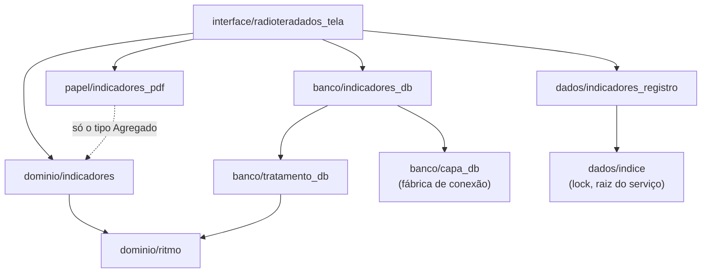
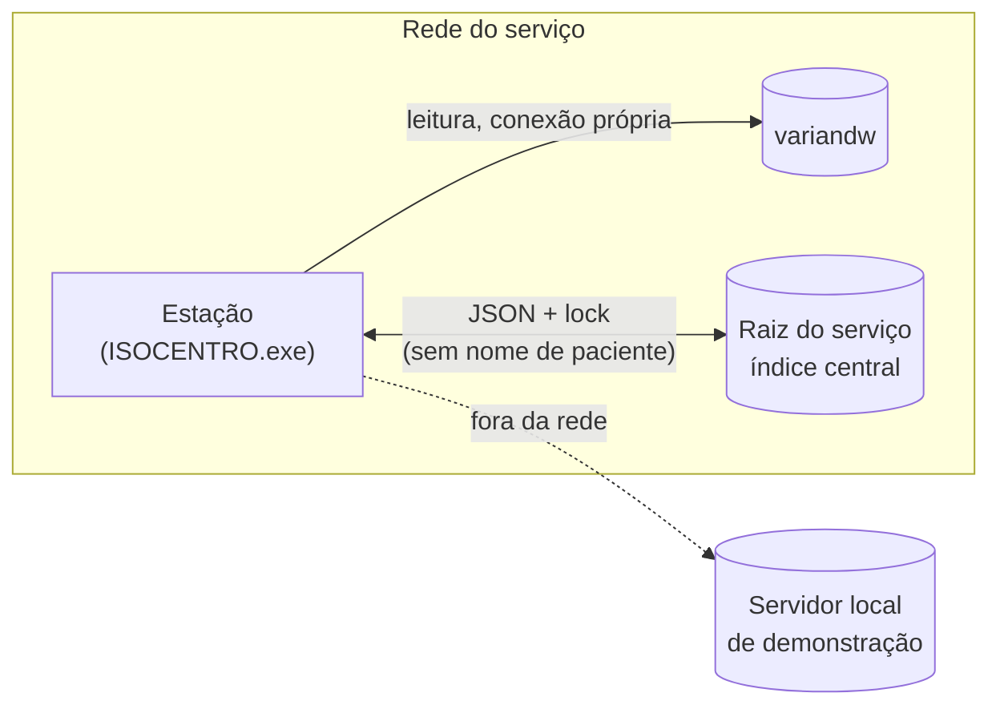

# Architecture Spine — Radioteradados

## Design Paradigm

**Camadas por papel no fluxo** — a divisão do pacote `isocentro/` —, com **núcleo funcional puro** como regra **nova**, que vale para os módulos do Radioteradados (o `dominio/` atual não é todo puro: `gatilho.py` importa `banco/` e `dados/`, `qualidade_metodo.py` importa Qt). Toda regra de cálculo mora em funções puras; a leitura do banco, a gravação do estado e a tela são a casca.

| Camada | Pasta | No Radioteradados |
| --- | --- | --- |
| Fonte clínica (somente leitura) | `banco/` | `indicadores_db.py`: SQL, portão `VERIFICADO_EM`, dados brutos por curso |
| Regra e cálculo (puro) | `dominio/` | `ritmo.py` (frequência, calendário, frações — extraído do `tratamento_db`); `indicadores/` (pacote: fichas, fórmulas, tipos, supressão, recorte) |
| Estado gravado pelo app | `dados/` | `indicadores_registro.py`: aprovações, classificações, conferência, cache provisório, retratos, relatórios emitidos |
| Papel | `papel/` | `indicadores_pdf.py`: relatório mensal |
| Tela | `interface/` | `radioteradados_tela.py`: a aba; o cálculo e as gravações em `QThread` |



`dominio/indicadores` e `dominio/ritmo` não importam `PyQt5`, `isocentro.banco` nem `isocentro.dados`; um teste falha se importarem.

## Invariants & Rules

### AD-1 — Camadas e direção de dependência [ADOPTED]

- **Binds:** all
- **Prevents:** SQL dentro da tela, fórmula dentro do módulo de banco, tela que calcula, domínio que consulta.
- **Rule:** SQL só em `banco/indicadores_db.py` (e no que ele reaproveita do `tratamento_db`, AD-12); fórmula, recorte e supressão só em `dominio/indicadores`; frequência, calendário e contagem de frações só em `dominio/ritmo`; gravação só em `dados/indicadores_registro.py`; a tela orquestra e desenha. Direção conforme o diagrama; a pureza do domínio é verificada por teste.

### AD-2 — Um dono para frequência, calendário e contagem de frações

- **Binds:** FR-4, FR-5, FR-6, FR-10, FR-11, FR-13, RD-2
- **Prevents:** Ficha Virtual e Radioteradados discordarem sobre o mesmo curso; frequência desconhecida tratada como diária; feriado contado num indicador e não no outro.
- **Rule:** `dominio/ritmo.py` é o único dono de: tradução e colapso da frequência das prescrições de um curso (a regra hoje no `tratamento_db`: "a diária ganha; sem diária, a menor em ordem alfabética"), `ritmo(frequencia) -> (dias, por) | None` (desconhecida = `None`, nunca diária), contagem de frações entregues e de pausas (semântica atual de `fracoes_entregues`/`intervalos_das_sessoes`), e todo cálculo de dia útil (entre datas, somar dias, dias do período) com um calendário de feriados opcional. O `tratamento_db` passa a importar daí e mantém o fallback diário **só** no `prever_fim` da Ficha Virtual, sem feriados: a Ficha Virtual e a Capa não mudam (teste de regressão no mesmo trabalho). Falha de leitura da frequência vira "frequência não identificada", nunca diária. O mapa valor de frequência → família de limiar (semanal ou não) é parâmetro da ficha técnica (AD-4).

### AD-3 — Agregado e lista de origem: mesma passada, tipos separados

- **Binds:** FR-4 a FR-19, RD-1, RD-3
- **Prevents:** lista que não soma o número; nome de paciente chegando ao PDF ou à gestão dentro de um objeto que "deveria ser ignorado".
- **Rule:** cada fórmula de `dominio/indicadores` produz, numa só passada sobre o mesmo conjunto de cursos, um `Agregado` e uma `ListaOrigem` separados (dataclasses congeladas). `Agregado`: valor, numerador, denominador, contagem de excluídos, versão da ficha e da fórmula, data da carga (ou `Ausente`), data do cálculo, degrau da fonte, estado enumerado (oficial, não oficial, em andamento, provisório, maduro aguardando congelamento, carga incompleta, definitivo, definição superada, retrato desatualizado, experimental, fonte faltando, fora do banco, só teleterapia, capacidade não configurada) e carimbo do instantâneo de estado usado. `ListaOrigem`: por curso, `ChaveCurso` (AD-13), médico do curso, atributos de recorte, contribuição (numerador, denominador, excluído) e motivo como código + texto. `Ausente(motivo)` substitui qualquer valor sem fonte. O PDF só aceita `Agregado` (testado); a tela só recebe `ListaOrigem` pela entrega filtrada do AD-8.

### AD-4 — Fichas técnicas no código; aprovação derivada

- **Binds:** FR-16, FR-17, SM-3, SM-C1, RD-1
- **Prevents:** duas fontes de parâmetro; prazo ou limiar mudados sem nova aprovação; aprovação "revogada" por sobrescrita.
- **Rule:** cada ficha técnica (fórmula, parâmetros como 30 dias, 7 + 3, 60 dias e o mínimo de 5, exclusões, regras de atribuição de recorte, mapa de frequência → limiar) é código versionado em `dominio/indicadores`; mudar qualquer parâmetro ou lógica sobe a versão da ficha ou da fórmula, com teste e commit. O estado do serviço guarda só aprovações por `(indicador, versão_da_ficha, versão_da_fórmula)`, nunca editadas. "Aprovada" é derivada por uma função só do domínio: existe aprovação para exatamente as versões em uso. Mudança de configuração do serviço que entra numa fórmula (feriados, códigos de atividade, capacidade) muda a impressão digital da configuração gravada no `Agregado` e aparece na ficha como "configuração alterada depois da aprovação".

### AD-5 — Estado do serviço: raiz única, sem nome de paciente

- **Binds:** FR-17, FR-19, FR-20, FR-21, FR-22, RD-5
- **Prevents:** estações gravando por cima uma da outra ou em arquivos diferentes; classificação, aprovação ou físico responsável vindo de outra pasta; nome de paciente em arquivo compartilhado.
- **Rule:** aprovações, classificações, conferência, cache provisório, retratos e índice de relatórios são estado do serviço, em arquivos JSON numa **raiz única**: a pasta do índice central (`indice.REGISTRO_PATH`). Não há variável de ambiente por arquivo (variável só para teste e demonstração, e a aba mostra o caminho quando não for o padrão). Ciclo ler-alterar-gravar sob `indice.travar_arquivo`, fora da thread da tela; históricos só acrescentam. Todo arquivo tem campo `versao`, entra no `dados/backup.py` e, ilegível, é preservado e anunciado (padrão do `registro_json`), nunca lido como vazio. **Nenhum arquivo do estado do serviço contém nome ou registro de paciente**: só `ChaveCurso` (AD-13). Sem pasta do serviço configurada (a raiz cairia na pasta do programa ou do repositório), o Radioteradados **recusa gravar** e avisa; teste e demonstração usam pasta temporária por variável. A configuração do serviço (AD-10) é lida da mesma raiz; `ISOCENTRO_CONFIG` só vale em teste e demonstração, e o físico responsável nunca vem de variável. Nenhum entra no git; o log nunca registra identificação de paciente.

### AD-6 — Mês provisório, cache e retrato congelado pelo físico

- **Binds:** FR-1, FR-2, FR-3, FR-17, FR-21, NFR-1, NFR-2, RD-4
- **Prevents:** mês congelado com dado imaturo, carga incompleta, definição não aprovada ou programa desatualizado; reserva divergente entre estações; recorte de mês congelado recalculado com dado de hoje.
- **Rule:**
  - Provisório é recalculado em `QThread`; o resultado por curso (o conteúdo da `ListaOrigem` sem nome, mais o `Agregado` do serviço inteiro) é gravado como **cache provisório** com a data do cálculo. É a "última leitura" do FR-21 (degrau "cache") e o que permite a NFR-2.
  - Estação com versão de fórmula diferente da aprovada calcula para a própria tela, marcado "não oficial", e **não grava** cache.
  - Mês com data da carga conhecida e anterior ao fim do mês fica "carga incompleta"; desconhecida, `Ausente` ao lado da data do cálculo.
  - **Congelar** é ação explícita do físico responsável (decisão de 13/10/2026, que atualiza o PRD). Mês maduro e não congelado fica "maduro, aguardando congelamento". O botão só acende com a faixa EXPERIMENTAL já fora (AD-9), o mês maduro (sem curso da coorte em andamento nem encerramento a classificar, ou passado o teto de 3 meses), a data da carga conhecida e cobrindo o mês, todas as fichas aprovadas e a versão das fórmulas do programa igual à aprovada. Apagado, mostra o motivo.
  - O retrato guarda, por indicador: o resultado por curso (`ChaveCurso`, atributos de recorte, contribuição, motivo, classificação vigente), as versões da ficha, da fórmula e do programa, a impressão digital da configuração, a data da carga, quem congelou e quando. Qualquer recorte de mês definitivo é um filtro sobre esse conjunto, sem consultar o banco; nomes são resolvidos na hora de exibir, só para quem pode ver.
  - Aprovar uma versão nova de ficha não altera retratos: o mês congelado mostra "definição superada" e pode ser congelado de novo, se o físico quiser.
  - Classificar ou reclassificar curso de mês congelado **não** altera o retrato: o mês fica "retrato desatualizado", e corrigir é congelar de novo, gerando um retrato versionado acrescentado.
  - Cálculo fora do lock; gravação "se ainda for a versão esperada"; quem perde a corrida descarta o próprio cálculo e lê o gravado.

### AD-7 — Relatório imutável, supressão por público

- **Binds:** FR-19, SM-5, RD-3
- **Prevents:** relatório arquivado mudando; versão do arquivo disputada entre estações; célula pequena reidentificável na tela da gestão ou no papel; célula suprimida deduzida por subtração.
- **Rule:** `dominio/indicadores.suprimir(agregados, publico)` é a única função de supressão: suprime quando numerador ou denominador for menor que o mínimo da ficha, e aplica a supressão complementar. O `Agregado` sai cru do cálculo. O PDF chama sempre com o público "agregado"; a tela chama com o público do papel (gestão = agregado; físico e médico = cru). O PDF carrega o estado de cada `Agregado`, inclusive "experimental". Emitir é alocar a versão e gravar a linha do índice **no mesmo lock**, criando o arquivo em modo exclusivo e registrando o hash; a pasta dos relatórios é chave própria (nunca a dos relatórios exportados do ARIA). Rodapé de `papel/rodape.py`.

### AD-8 — Papel `gestao` e permissão conferida onde se grava e onde se entrega

- **Binds:** FR-3, FR-17, FR-18, FR-22, UJ-2, UJ-4
- **Prevents:** gestão, papel vazio ou administrador vendo nome de paciente; médico vendo paciente de outro médico; aprovação ou classificação gravada por quem não é o físico responsável, por ferramenta ou teste.
- **Rule:**
  - O papel `gestao` entra em `auth.PAPEIS`, `administracao._FUNCAO_LABEL`, `MODOS_POR_PAPEL` (só o Radioteradados), `ROTULOS_MODO`, e fica fora do `MODOS_PADRAO`. O papel `medico` ganha o Radioteradados.
  - A `ListaOrigem` só é **entregue** por `dominio/indicadores.entregar_lista(lista, papel, medico_aria)`, a única porta: devolve a lista inteira para `fisico`, a dos próprios cursos para `medico` e nada para os demais. A tela nunca recebe a lista sem passar por ela. Papel vazio, desconhecido, `admin` ou `gestao` não a recebem.
  - O vínculo login → médico do ARIA (`ctrResourceSer`) é campo de `usuarios.json`, mantido pelo administrador; nunca casamento por nome. "Médico do curso" é definido uma vez no `indicadores_db` (o oncologista do vínculo do paciente, como na Agenda) e usado no recorte e no filtro.
  - Aprovar, classificar, conferir e congelar: `dados/indicadores_registro` confere, a cada gravação, que o usuário recebido é o físico responsável da configuração (que nunca vem de variável de ambiente). A tela só esconde o botão. Estender a classificação à enfermagem é ampliar essa conferência.

### AD-9 — Faixa EXPERIMENTAL com três chaves

- **Binds:** FR-20, R-07
- **Prevents:** a faixa sair com a base de cursos não conferida, ou sair por uma chave que atesta outra consulta.
- **Rule:** a faixa só sai com: `indicadores_db.VERIFICADO_EM` preenchido; `tratamento_db.LISTA_VERIFICADA_EM` preenchido (R-07), válido só se atestou a versão estendida da base de cursos (AD-12); e a conferência registrada pelo físico responsável. `VERIFICADO_EM` vazio não bloqueia o cálculo: só mantém a faixa.

### AD-10 — Configuração do serviço: seção tipada no arquivo existente

- **Binds:** FR-7, FR-10, FR-13, FR-23
- **Prevents:** nome de atividade, capacidade ou feriado fixos no código; capacidade casada por nome; lista serializada em texto livre; configuração ilegível lida como vazia.
- **Rule:** o `config_servico.json` ganha uma seção própria do Radioteradados, com `versao`, lida por um leitor tipado em `dados/config_servico` que distingue *ausente* de *ilegível* (ilegível vira `Ausente` no `Agregado`). Contém: códigos de atividade (consulta, simulação), casados por código exato; capacidade diária por máquina, chaveada pelo `ctrResourceSer` (o `MachineId` é só rótulo); feriados; físico responsável (login) e janela do horário de tratamento (AD-14). O administrador edita pelo painel de administração, com autoria por chave. Parâmetros de cálculo não ficam aqui (AD-4).

### AD-11 — Consulta nova cabe no servidor local [ADOPTED]

- **Binds:** NFR-3, todas as consultas de `indicadores_db`
- **Prevents:** a aba funcionar só na rede da clínica, e a suíte quebrar.
- **Rule:** toda consulta usa só o T-SQL que `banco/servidor_local.traduzir` cobre (ou a tradução é estendida no mesmo trabalho) e ganha caso em `tests/test_servidor_local.py`. Um teste falha se alguma consulta do `indicadores_db` contiver `INSERT`, `UPDATE`, `DELETE`, `MERGE`, `EXEC` ou DDL. A conexão segue a mesma precedência (banco local → configurado), pela fábrica do AD-14.

### AD-12 — Um dono para curso, frações entregues e frações prescritas

- **Binds:** FR-4 a FR-15, FR-22, AD-9
- **Prevents:** a Ficha Virtual e o Radioteradados contarem cursos e frações por consultas diferentes; o R-07 atestar uma consulta e os números usarem outra.
- **Rule:** a base de cursos, frações entregues (datas) e frações prescritas do Radioteradados é a do `tratamento_db`, estendida para um período, paginada (sem teto silencioso de registros) e passando a devolver também o `ctrCourseSer`; não há consulta paralela de cursos. A frequência por curso é lida pelo `indicadores_db` com a mesma consulta do `tratamento_db`, paginada; o `_marcar_frequencia` da Ficha Virtual fica como está. Estender a consulta exige reconferir o R-07 contra a versão estendida (AD-9). "Frações prescritas do curso" é uma função só (última revisão aprovada; reforço sequencial soma), até a pergunta 6 do PRD ser respondida.

### AD-13 — Identidade estável de curso, máquina e pessoa

- **Binds:** FR-3, FR-10, FR-17, FR-22, AD-5, AD-6
- **Prevents:** classificação órfã depois de recarga do data warehouse (abandono zerado); máquina sem par; pessoa casada por homônimo.
- **Rule:** `ChaveCurso = ctrCourseSer` — a chave de origem do curso no ARIA, única e sem identificar o paciente; nunca o `PatientId` (que neste app é o registro) nem a chave substituta do DW (`DimCourseID`, que só pode aparecer dentro de uma consulta, nunca gravada). Tipo único de `dominio/indicadores`, usado por `banco/`, `dados/` e retratos; nome e registro são resolvidos pelo `banco/` na hora de exibir. Máquina = `ctrResourceSer`. Pessoa = login do `auth`, gravado junto do nome de exibição na data. Uma classificação só se aplica se a última fração entregue do curso for a registrada nela; senão fica "classificação superada" e sai da conta.

### AD-14 — Conexão própria e carga no banco clínico

- **Binds:** NFR-1, NFR-2, RD-4
- **Prevents:** o cálculo e a Ficha Virtual se atrapalhando na conexão única do `capa_db` (um tempo-limite derrubando a consulta da outra thread); o painel degradando o ARIA em horário de tratamento.
- **Rule:** o cálculo usa uma conexão própria por thread, obtida de uma fábrica do `capa_db` com a mesma precedência e tempo-limite declarado próprio; nunca toca a conexão global nem a solta. Consultas agregadas por mês (sem laço por paciente), uma por necessidade de dado e mês. Cálculo automático só fora da janela de horário de tratamento configurada; dentro dela, só por pedido explícito do usuário. O worker lê o estado do serviço (classificações, aprovações, configuração) **uma vez** no início e calcula sobre esse instantâneo.

## Consistency Conventions

| Concern | Convention |
| --- | --- |
| Nomes | Termos do Glossário do PRD, em português, no código e na tela. IDs de indicador estáveis em minúsculas (`tempo_medio`, `abandono`, `interrupcao`, `simulacao`…). |
| Datas | `date` no domínio; `DD/MM/AAAA` na tela e no papel; mês `AAAA-MM`. Data de referência ("mês anterior", "Impresso em") = relógio da estação, aceito. |
| Ausência | Sem fonte = `Ausente(motivo)`, nunca `0` nem lista vazia; a tela diz o motivo. Data da carga ainda não mapeada = `Ausente("carga do data warehouse não mapeada")`, sempre ao lado da data do cálculo. |
| Degrau | Enumerado no `Agregado`: banco, banco local (demonstração), cache provisório, retrato. Substitui, para esta aba, os degraus da Capa (banco, espelho, relatório exportado), que não se aplicam aqui. Quem exibe, mostra. |
| Estados | Enumerados no `dominio/indicadores`, com o texto de exibição num lugar só; tela e PDF usam o mesmo. |
| Erros e log | Falha vira `Ausente` + motivo, sem derrubar a aba; log pelo `log_app`, sem identificação de paciente. |
| Interface | `ui.py` e `estilo.py`; sem verde como cor de ação nem como cor de série em gráfico (verde é dose); layout descrito em texto e aceito antes de codificar. |
| Testes | Fórmulas testadas no domínio, sem Qt nem banco, com casos conferidos à mão **só com pseudônimos** (`900NNNN`, base do servidor local), nunca dado real; `tools/varrer_identidade.py` antes do commit. Teste de pureza dos módulos de domínio; regressão da Ficha Virtual e da Capa ao extrair o `dominio/ritmo`; teste de que o PDF só aceita `Agregado`; testes para RD-3 (supressão e complementar), RD-4 (congelamento barrado sem data da carga) e RD-5 (nenhum nome em arquivo de estado nem em log). Tela conferida pelo `tools/tela.py`. |

## Stack

Sem dependência nova; tudo já fixado em `requirements.txt` (conferido no projeto e na web em 13/10/2026).

| Name | Version |
| --- | --- |
| Python | 3.12 (só correções de segurança; fim de vida 10/2028) |
| PyQt5 | 5.15.11 (última versão do PyQt5; suporte padrão do Qt 5.15 encerrado em 05/2025) |
| matplotlib (gráficos da tela e do PDF) | 3.10.9 |
| reportlab (relatório) | 4.5.1 |
| pyodbc | 5.3.0 |

## Structural Seed

```text
isocentro/
  banco/indicadores_db.py           # SQL agregado por mês; reaproveita a base de cursos do tratamento_db (AD-12)
  dominio/ritmo.py                  # frequência, calendário com feriados, contagem de frações (AD-2)
  dominio/indicadores/              # pacote: tipos.py (Agregado, ListaOrigem, ChaveCurso, Ausente, estados),
                                    #   fichas.py (versões e parâmetros), um módulo por indicador, recorte.py, supressao.py
  dados/indicadores_registro.py     # aprovações, classificações, conferência, cache, retratos, relatórios (AD-5)
  papel/indicadores_pdf.py          # relatório mensal (só Agregado)
  interface/radioteradados_tela.py  # a aba; QThread para cálculo e gravação
tests/
  test_ritmo.py                     # inclui regressão da Ficha Virtual e da Capa
  test_indicadores_dominio.py       # fórmulas com casos pseudonimizados conferidos à mão; pureza
  test_indicadores_registro.py      # lock, raiz única, histórico, nenhum nome, permissão
```



**Implantação e operação:** o mesmo executável de sempre (`tools/gerar_executavel.py`), sem processo, porta ou serviço novo. Todas as estações são atualizadas antes de o físico aprovar uma versão nova de fórmula; estação com versão de fórmula diferente da aprovada calcula como "não oficial" e não congela mês. Os arquivos de estado entram na cópia de segurança do `dados/backup.py`.

## Capability → Architecture Map

| Área do PRD | Lives in | Governed by |
| --- | --- | --- |
| FR-1 a FR-3 (aba, período, recorte) | `interface/radioteradados_tela` + `dominio/indicadores/recorte` | AD-1, AD-6, AD-8 |
| FR-4 a FR-8 (núcleo RDC) | `dominio/indicadores` + `dominio/ritmo` + `banco/indicadores_db` | AD-2, AD-3, AD-4, AD-12 |
| FR-9 a FR-15 (camada operacional) | idem | AD-2, AD-3, AD-10, AD-12 |
| FR-16, FR-17 (ficha, aprovação) | `dominio/indicadores/fichas` + `dados/indicadores_registro` | AD-4, AD-5, AD-8 |
| FR-18 (lista de origem) | `dominio/indicadores`, entregue filtrada | AD-3, AD-8, AD-13 |
| FR-19 (relatório) | `papel/indicadores_pdf` | AD-3, AD-7 |
| FR-20 (faixa) | `interface/radioteradados_tela` | AD-9, AD-12 |
| FR-21 (reserva) | cache provisório em `dados/indicadores_registro` | AD-6 |
| FR-22 (classificar) | `dados/indicadores_registro` | AD-5, AD-8, AD-13 |
| FR-23 (configuração) | `dados/config_servico` (seção tipada) | AD-10 |
| NFR-1, NFR-2 (carga, tempo de tela) | `banco/indicadores_db` + cache | AD-6, AD-14 |

## Deferred

- **Data da carga do data warehouse** — a próxima rodada do mapeador procura a tabela ou o log; até lá, nenhum mês é congelado (AD-6) e a NFR-2 vale pelo cache provisório.
- **Valor de frequência do regime semanal** (pergunta 5 do PRD) — bloqueia só a entrada "semanal" do mapa de limiar na ficha da interrupção; até lá, frequência fora do mapa = não identificada.
- **Agenda da braquiterapia** — o `agenda_db` já lista o recurso GammaMed Plus; confirmar que é a fonte da última sessão (FR-15).
- **SQLite (SQLModel) no lugar de JSON + lock** — volume da v1 é pequeno; revisitar se o lock virar gargalo ou quando Vencimentos/QA migrarem.
- **Cálculo na concentradora** — revisitar depois do R-08, se a carga ou o tempo de tela pedirem.
- **pyqtgraph** — sem necessidade de interação rápida na v1.
- **Migração para PyQt6 / Qt 6** — fora da v1; a tela nova evita APIs removidas no Qt 6.
- **Multi-instituição, marca e comercialização** — fora da v1 (PRD §5).
- **Indicadores de conformidade, Revisão Semanal, tempo de acelerador perdido** — v2; entram como fichas novas pelo AD-4, sem mudar a arquitetura.
